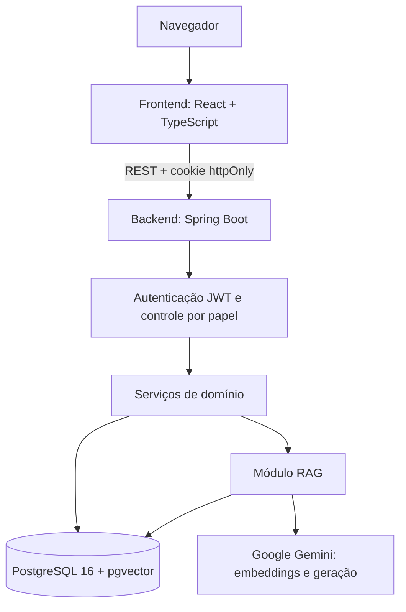

# IABill

Sistema web multilocatário de apoio à adequação à LGPD e ao RGPD, com geração documental assistida por IA, recusa em caso de contexto insuficiente, validação humana e trilha de auditoria.

Artefato do Trabalho de Conclusão de Curso **"Sistema web para apoio estruturado à adequação à LGPD e RGPD com uso controlado de inteligência artificial"**, do curso de Ciência da Computação da Universidade do Extremo Sul Catarinense (Unesc).

- **Autor:** Daniel Felisberto dos Santos
- **Orientação:** Matheus Leandro Ferreira

> **Estado do projeto:** protótipo acadêmico. Os documentos gerados não passaram por validação jurídica formal e não substituem a análise de um profissional habilitado.

## Acesse o sistema

O IABill está disponível em **[iabill.com](https://iabill.com)**. Para usar o site não é preciso instalar nada nem configurar chaves.

### Contas de teste

As contas abaixo pertencem à NexTech, empresa fictícia usada na demonstração. Todas usam a senha `NexTech@2026`.

| E-mail |
| --- |
| `ana.silva@nextech.com.br` |
| `carlos.mendes@nextech.com.br` |
| `juliana.rocha@nextech.com.br` |

Não insira dados pessoais reais nessas contas, porque elas são públicas.

## O problema

Pequenas e médias empresas têm dificuldade para transformar as exigências da LGPD e do RGPD em atividades concretas. Modelos de linguagem podem ajudar a redigir documentos, mas também podem inventar informações, o que é um risco sério em textos de natureza legal.

O IABill organiza o processo de adequação e limita o uso da IA com cinco mecanismos combinados:

1. Geração ancorada nos documentos aprovados da própria organização (RAG).
2. Instrução de recusa quando o contexto recuperado é insuficiente.
3. Recuperação semântica restrita ao workspace.
4. Validação humana antes de o conteúdo se tornar oficial.
5. Trilha de auditoria que registra também as ações da IA.

## Funcionalidades

| Área | O que o sistema oferece |
| --- | --- |
| Inventário e governança | Registro de atividades de tratamento (ROPA), setores, fornecedores, transferência internacional, retenção e descarte |
| Documentos | Geração assistida, RIPD/DPIA, Política de Segurança da Informação, material de treinamento, publicação da Política de Privacidade, exportação em PDF |
| Fluxo de aprovação | Estados `DRAFT` → `GENERATED` → `REVIEWED` → `APPROVED`, com retorno a `DRAFT` em caso de rejeição, nova revisão após edição e bloqueio de documentos aprovados |
| Busca e assistente | Busca semântica por workspace e chat com chamada de funções |
| Direitos e consentimento | Canal público para solicitações de titulares e registro público de consentimento |
| Incidentes | Registro com marcos separados para notificação à ANPD e aos titulares |
| Pessoas e controle | Colaboradores, treinamentos, comitê LGPD, plano de ação e diagnóstico |
| Acesso | Papéis `USER`, `ADMIN`, `DPO` e `SUPER_ADMIN`, JWT em cookie `httpOnly`, MFA por TOTP e limite de uso de IA por usuário |
| Conteúdo de apoio | Pilares, princípios, bases legais, sanções, glossário e Central de Ajuda |

## Arquitetura



O backend é uma aplicação única organizada em camadas (`controller`, `service`, `repository`, `model`, `dto`). Cada organização é um *tenant*, que possui um ou mais *workspaces*, aos quais se vinculam documentos e fragmentos.

### Fluxo RAG

1. **Ingestão:** ao aprovar um documento, o conteúdo é dividido em fragmentos de 1.000 caracteres, com sobreposição de 150, e convertido em vetores de 768 dimensões.
2. **Recuperação:** os 5 fragmentos mais próximos do mesmo workspace são buscados pela distância de cosseno.
3. **Geração:** o modelo redige usando somente esses fragmentos e é instruído a declarar quando não há dados suficientes.
4. **Validação humana:** o conteúdo gerado passa por revisão e aprovação.

### Tecnologias

| Camada | Tecnologia |
| --- | --- |
| Backend | Java 21, Spring Boot 4.1.0, Spring Security, Spring Data JPA, Flyway |
| Frontend | React 19, TypeScript, Vite, Tailwind CSS |
| Banco de dados | PostgreSQL 16 com pgvector |
| IA | Google Gemini: `gemini-embedding-001` e `gemini-2.5-flash` |
| Testes | JUnit 5, Mockito, Testcontainers |
| Implantação | AWS Elastic Beanstalk, RDS, S3, CloudFront e SES, com GitHub Actions e OIDC |

## Estrutura do repositório

```text
.
├── backend/                  API Spring Boot
│   ├── src/main/java/        Código da aplicação
│   ├── src/main/resources/   Configuração e migrações Flyway
│   ├── src/test/             Testes e golden dataset
│   └── rag-evaluation-results.csv   Resultados usados no TCC
├── frontend/                 Aplicação React
├── scripts/rag-evaluation/   Análise das métricas de avaliação
├── docker/                   Inicialização do banco local
├── docker-compose.yml        PostgreSQL com pgvector
└── .github/workflows/        Testes e implantação
```

## Como executar localmente

### Pré-requisitos

- JDK 21
- Node.js 22 ou superior
- Docker
- Uma chave própria da API do Google Gemini, necessária para busca, geração e aprovação de documentos

A chave pode ser criada no [Google AI Studio](https://aistudio.google.com/apikey). Sem ela, o sistema inicia normalmente, mas essas três funções ficam indisponíveis. A chave nunca deve ser versionada no repositório.

### 1. Banco de dados

```bash
docker compose up -d
```

### 2. Backend

```bash
cd backend
export GEMINI_API_KEY="sua-chave"
./mvnw spring-boot:run
```

A API fica em `http://localhost:8080` e as migrações são aplicadas automaticamente.

### 3. Frontend

```bash
cd frontend
npm ci
npm run dev
```

A aplicação fica em `http://localhost:5173`.

### 4. Primeiro acesso

Crie uma conta pela tela de cadastro. O e-mail de confirmação depende do Amazon SES e não é enviado no ambiente local, então confirme a conta diretamente no banco:

```bash
docker exec lgpd-assistant-db psql -U lgpd_admin -d lgpd_assistant -c "UPDATE users SET email_verified = true WHERE email = 'seu-email@exemplo.com';"
```

### Variáveis de ambiente

| Variável | Uso | Padrão |
| --- | --- | --- |
| `GEMINI_API_KEY` | Acesso à API do Gemini | vazio |
| `JWT_SECRET` | Assinatura dos tokens; obrigatório fora do ambiente local | valor de desenvolvimento |
| `COOKIE_SECURE` | Marca o cookie como `Secure`; usar `true` com HTTPS | `false` |
| `COOKIE_SAME_SITE` | Política `SameSite` do cookie | `Lax` |
| `SPRING_DATASOURCE_URL`, `SPRING_DATASOURCE_USERNAME`, `SPRING_DATASOURCE_PASSWORD` | Conexão com o banco | banco local do `docker-compose.yml` |
| `VITE_API_BASE_URL` | Endereço da API usado pelo frontend | `http://localhost:8080/api/v1` |

Nunca coloque chaves ou senhas reais em arquivos versionados.

## Testes

A suíte padrão tem 55 testes, entre unitários e de integração. Os testes de integração usam um PostgreSQL real em contêiner, portanto o Docker precisa estar em execução.

```bash
cd backend
./mvnw test
```

No Windows, se aparecer o erro `Unable to establish loopback connection`, aponte o socket interno do Java para outra pasta existente:

```bash
./mvnw test "-DargLine=-Djdk.net.unixdomain.tmpdir=C:\caminho\para\uma\pasta"
```

Para verificar o frontend:

```bash
cd frontend
npm run build
npm run lint
```

## Avaliação do RAG

A avaliação usa um conjunto autocontido em `backend/src/test/resources/golden_dataset.json`:

- 40 documentos sintéticos: 30 documentos-alvo e 10 distratores.
- 30 consultas positivas.
- 6 consultas negativas: 3 em workspace vazio e 3 fora do escopo do corpus.

Resultados registrados em `backend/rag-evaluation-results.csv`:

| Métrica | Valor |
| --- | --- |
| Precision@1 | 1,000 |
| Recall@5 | 1,000 |
| MRR | 1,000 |
| Taxa de recusa correta | 100% |

Esses números valem apenas para esse conjunto controlado. O corpus é sintético, as consultas foram escritas a partir dos documentos-alvo e a amostra é pequena, portanto eles não permitem generalizar para documentos reais.

### Como reproduzir

A classe `RagEvaluationTest` chama a API real do Gemini e pertence ao grupo `evaluation`, excluído da suíte padrão. Com o Docker ligado e `GEMINI_API_KEY` definida, execute:

```bash
cd backend
./mvnw test -Dgroups=evaluation -DexcludedGroups=none -Dtest=RagEvaluationTest
```

O comando regrava `backend/rag-evaluation-results.csv`. Depois, gere o resumo e os gráficos a partir da raiz do repositório:

```bash
pip install pandas matplotlib
python scripts/rag-evaluation/evaluate_rag_metrics.py backend/rag-evaluation-results.csv
```

## Limitações

- A avaliação usa corpus sintético, poucas consultas e um único modelo generativo.
- A recusa foi medida, mas a ocorrência de alucinações em documentos gerados com contexto suficiente não foi.
- Não houve estudo com usuários reais nem medição de ganho de tempo.
- As métricas operacionais vêm de apenas 11 gerações, o que não permite inferir o comportamento sob carga.
- Os testes automatizados não cobrem a permissão por papel do Encarregado nem o isolamento da busca vetorial.
- A mesma pessoa pode revisar e aprovar um documento, e não há fluxo de nova versão para documentos aprovados.
- O aviso de prazo de incidentes não considera feriados nem a contagem em dobro para agentes de pequeno porte.

## Licença

Trabalho acadêmico. Nenhuma licença de código aberto foi definida até o momento.
